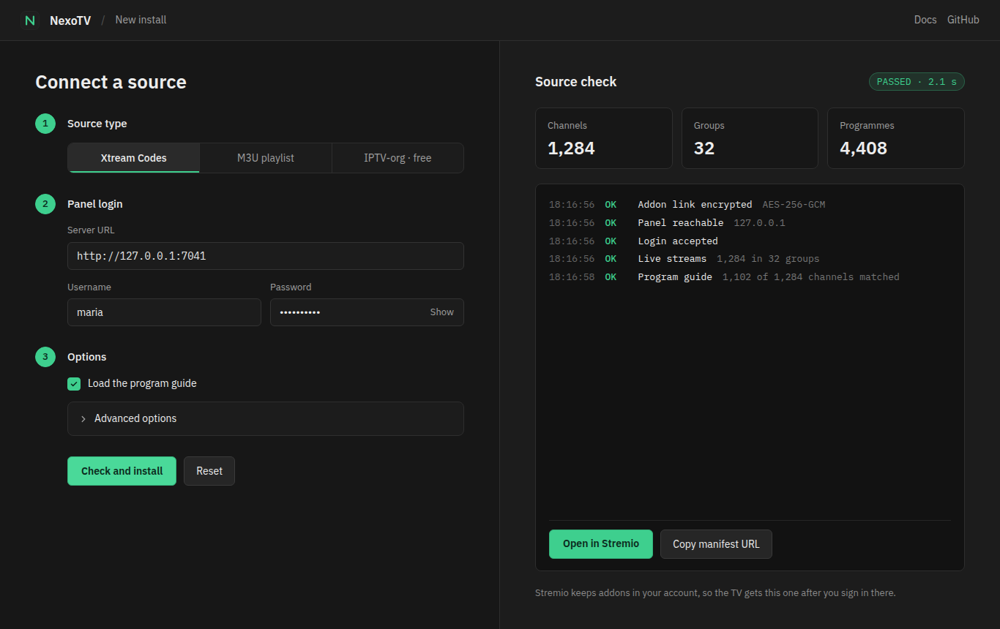
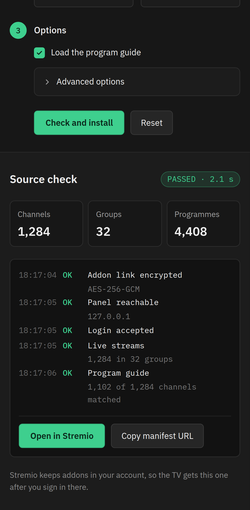

<p align="center">
  
</p>

<p align="center">
  Watch your IPTV channels in Stremio. NexoTV turns an Xtream Codes panel, an M3U playlist, or the free iptv-org list into a Stremio addon with channels, logos, and a program guide.
</p>

<p align="center">
  <a href="https://github.com/joaosavi/nexotv/releases/latest"></a>
  <a href="https://hub.docker.com/r/savibrabo/nexotv"></a>
  <a href="https://github.com/joaosavi/nexotv/actions/workflows/test.yml"></a>
  <a href="LICENSE"></a>
</p>

<p align="center">
  <a href="https://263f84288ddb-nexotv.baby-beamup.club/configure"><strong>Open the public instance</strong></a>
</p>

<table>
  <tr>
    <td width="68%"></td>
    <td width="32%"></td>
  </tr>
</table>

## Features

- **Three sources.** Xtream Codes panels, M3U and M3U+ playlists, and the free [iptv-org](https://github.com/iptv-org/iptv) channels filtered by country and category.
- **Program guide.** Each channel shows what is on now and next, from the panel's XMLTV, the playlist's `url-tvg`, or a custom guide URL. Gzipped guides work too.
- **Source check before install.** The configure page tests the source and reports channels, groups, and guide coverage, with a clear reason when a step fails.
- **One instance, many users.** Each configuration lives in a token inside the addon URL, encrypted when `CONFIG_SECRET` is set, so there are no accounts to manage.
- **Native TV guide** for self-hosted instances: Stremio's Discover opens the catalog as a program grid.
- **Light on memory.** The guide is parsed as a stream, and movies and series in M3U+ playlists are skipped by default.

## Quick start

### Use the public instance

Open the [configure page](https://263f84288ddb-nexotv.baby-beamup.club/configure), pick your source, and click **Check and install**. When the check passes, click **Open in Stremio**.

Stremio saves addons to your account, so the addon also appears on your TV and phone after you sign in there.

### Self-host with Docker

```bash
docker run -d --name nexotv \
  -p 7000:7000 \
  -e CONFIG_SECRET="$(openssl rand -hex 32)" \
  -v ./data:/app/data \
  --restart unless-stopped \
  savibrabo/nexotv:latest
```

Then open `http://localhost:7000/configure`.

Keep `CONFIG_SECRET` the same across restarts. If it changes, every installed addon stops working until it is configured again.

To use the addon from other devices, serve NexoTV over HTTPS, for example behind Caddy, Traefik, or a Cloudflare Tunnel. Stremio loads remote addons only over HTTPS, and accepts plain `http://` only for `localhost` and `127.0.0.1`.

A [`docker-compose.yml`](docker-compose.yml) is included. Copy [`.env.example`](.env.example) to `.env` and run `docker compose up -d`.

## Configuration

NexoTV runs with no configuration. These are the variables most installs change:

| Variable | Default | What it does |
| --- | --- | --- |
| `CONFIG_SECRET` | unset | Encrypts the token in each addon URL. Set it on any instance other people use |
| `PORT` | `7000` | HTTP port |
| `EPG_NATIVE_ENABLED` | `false` | Turns on the native TV guide. It keeps days of programmes per user in memory |
| `M3U_INCLUDE_VOD` | `false` | Keeps movies and series from M3U+ playlists |
| `ADDON_NAME` | `NexoTV` | Addon name shown in Stremio |

[`.env.example`](.env.example) lists every variable with its default: cache, refresh intervals, timeouts, rate limits, and memory alerts.

## Development

You need Node.js 22, pnpm 9 (`corepack enable` picks the pinned version), and a C++ toolchain for `better-sqlite3`.

```bash
git clone https://github.com/joaosavi/nexotv.git
cd nexotv
pnpm install
pnpm dev          # backend on :7000, configure page with hot reload
pnpm build        # production build of both packages
pnpm --filter backend test
```

The repository is a pnpm workspace:

- `packages/backend` is the Express server: the Stremio addon routes, the providers, the M3U and XMLTV parsers, and the SQLite cache.
- `packages/frontend` is the configure page, built with Vue 3 and Vite.

The end-to-end tests in `packages/backend/tests/e2e` start a fake IPTV provider and run real requests through the addon, so most changes can be checked without opening Stremio.

## Contributing

Bug reports and pull requests are welcome. Open an [issue](https://github.com/joaosavi/nexotv/issues) first for larger changes. Before you send a pull request, run `pnpm --filter backend build:check` and `pnpm --filter backend test`.

## Disclaimer

NexoTV does not provide, host, or distribute any content. You are responsible for the sources you add and for following your provider's terms and the law where you live.

## License

[MIT](LICENSE) © [joaosavi](https://github.com/joaosavi)
