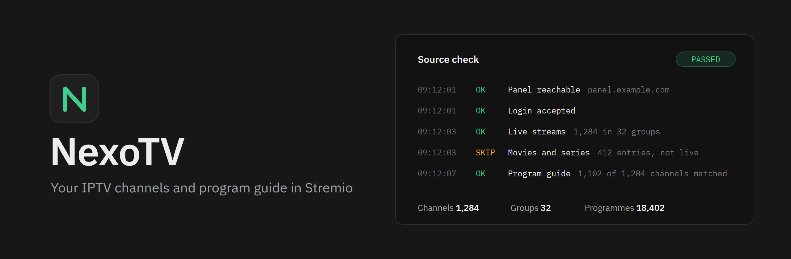
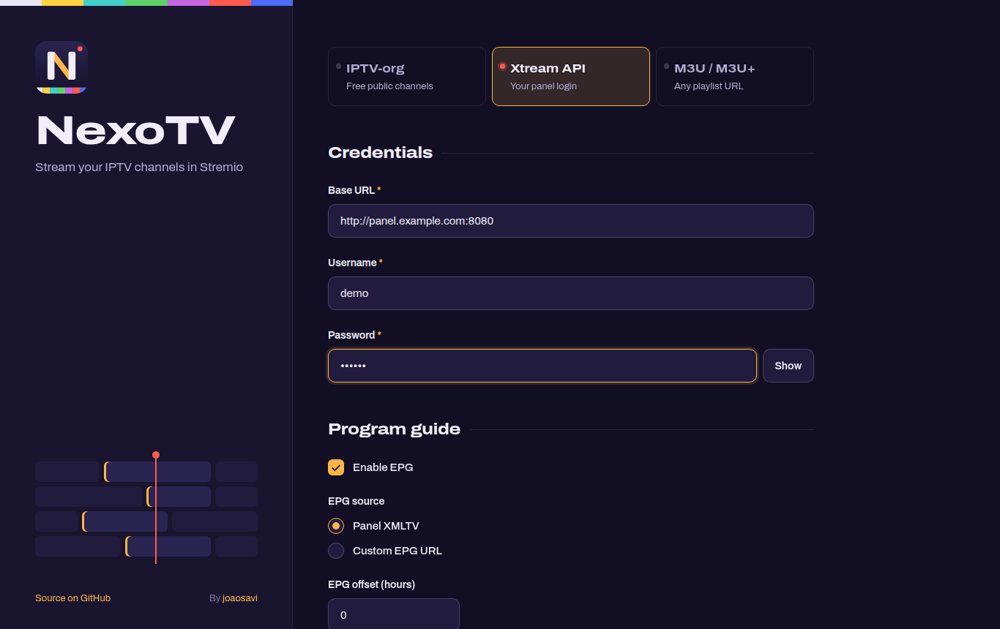
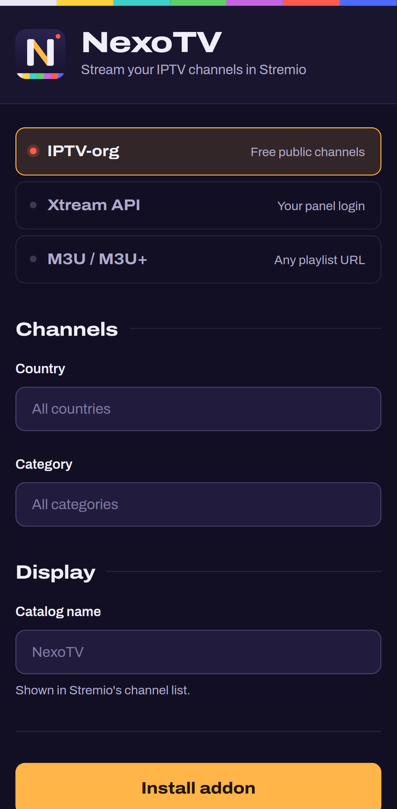

<p align="center">
  
</p>

<p align="center">
  A self-hostable Stremio addon for live TV. It reads an Xtream Codes panel, an M3U playlist, or the free iptv-org database and shows the channels, the program guide and the logos inside Stremio.
</p>

<p align="center">
  <a href="https://github.com/joaosavi/nexotv/stargazers"></a>
  <a href="https://github.com/joaosavi/nexotv/releases/latest"></a>
  <a href="https://hub.docker.com/r/savibrabo/nexotv"></a>
  <a href="LICENSE"></a>
</p>

<p align="center">
  <a href="https://263f84288ddb-nexotv.baby-beamup.club/configure"><strong>Open the public instance</strong></a>
  &nbsp;&nbsp;|&nbsp;&nbsp;
  <a href="#self-host-with-docker">Self-host</a>
  &nbsp;&nbsp;|&nbsp;&nbsp;
  <a href="#environment-variables">Configuration</a>
  &nbsp;&nbsp;|&nbsp;&nbsp;
  <a href="#faq-and-troubleshooting">FAQ</a>
</p>

<table>
  <tr>
    <td width="70%"></td>
    <td width="30%"></td>
  </tr>
</table>

## Contents

- [Quick start](#quick-start)
- [Providers](#providers)
- [Features](#features)
- [Native TV guide](#native-tv-guide)
- [Environment variables](#environment-variables)
- [FAQ and troubleshooting](#faq-and-troubleshooting)
- [Support the project](#support-the-project)

## Quick start

### Use the public instance

1. Open [the public configure page](https://263f84288ddb-nexotv.baby-beamup.club/configure).
2. Pick a provider tab and fill in the fields.
3. Click **Install addon**, then **Open in Stremio**.

The public instance runs with the default settings, so the native TV guide is off there. To get it, self-host.

### Self-host with Docker

```bash
docker run -d \
  --name nexotv \
  -p 7000:7000 \
  -e CONFIG_SECRET="$(openssl rand -hex 32)" \
  -v ./data:/app/data \
  --restart unless-stopped \
  savibrabo/nexotv:latest
```

Open `http://localhost:7000/configure` on the same machine. The `./data` volume keeps the SQLite cache across restarts.

`CONFIG_SECRET` encrypts the personal token in each manifest URL. Keep the same value across restarts. If it changes, every installed addon stops working and each user must configure it again.

### Self-host with Docker Compose

```bash
git clone https://github.com/joaosavi/nexotv.git
cd nexotv
cp .env.example .env    # set CONFIG_SECRET at minimum
docker compose up -d
```

### Run from source

You need Node.js 18 or later, pnpm, and a C++ toolchain (`python3`, `make`, `g++`) for the `better-sqlite3` native module.

```bash
git clone https://github.com/joaosavi/nexotv.git
cd nexotv
cp .env.example .env
pnpm install
pnpm build
node packages/backend/dist/server.js
```

### Reach the instance from other devices

Stremio installs remote addons only over HTTPS. It accepts plain `http://` for `localhost` and `127.0.0.1` only.

- On the machine that runs NexoTV, `http://localhost:7000/configure` works as is.
- For a TV, a phone, or any other device, put NexoTV behind HTTPS. A reverse proxy such as Caddy or Traefik with a certificate works, and so does a tunnel such as Cloudflare Tunnel.

> [!IMPORTANT]
> In this README, `your-host` is a placeholder. Replace it with your own domain, for example `https://tv.example.com/configure`. Do not type `your-host` into Stremio or the browser.

## Providers

| Tab | What you enter | Program guide (EPG) |
| --- | --- | --- |
| **IPTV-org** | Nothing. Optionally filter by country and category. | Not available |
| **Xtream API** | Panel URL, username, and password. Live TV only. | The panel's `xmltv.php`, or a custom XMLTV URL |
| **M3U / M3U+** | A playlist URL, including Xtream `type=m3u_plus` links | The playlist's `url-tvg` header, or a custom XMLTV URL |

NexoTV is a live-TV addon, so the M3U tab skips Xtream movies and series (`/movie/` and `/series/` URLs) by default. Set `M3U_INCLUDE_VOD=true` to keep them.

All three tabs accept a **Catalog name**, which replaces the addon name in Stremio's channel list. Xtream and M3U also take an EPG offset in hours, for guides published in the wrong time zone.

To change an installed addon, open its configure page from Stremio. The page opens on the same tab with your settings filled in.

## Features

- **Per-user tokens.** Each configuration is encoded in its manifest URL, so one instance serves many users. With `CONFIG_SECRET` set, the token is encrypted with AES-256-GCM. Without it, the token is Base64URL and contains the credentials in readable form.
- **Program guide.** Stremio's meta panel shows the current program and the upcoming schedule.
- **User-Agent presets for M3U.** Choose TiviMate, IPTV Smarters Pro, GSE Smart IPTV, VLC, Kodi, or a custom value. A User-Agent set per channel in the playlist wins over the preset.
- **Three cache layers.** SQLite on disk keeps channels and EPG per configuration. An in-memory LRU deduplicates concurrent requests. Channel and EPG data leaves RAM after `DATA_MEMORY_TTL_MS` of idle time and reloads from SQLite on demand.
- **Background refresh.** Channels and EPG refresh on a timer, independent of user traffic.
- **Protection for public instances.** Outbound fetches resolve DNS and reject private addresses (SSRF protection). Rate limits apply per IP and per token.
- **Logo proxy.** Channel logos load through a proxy with fallback sources and optional reformatting.
- **Health endpoint.** `GET /health` reports uptime, heap, RSS, CPU, and cache size.

## Native TV guide

With `EPG_NATIVE_ENABLED=true`, the catalog opens in Stremio's Discover as a program grid instead of a plain channel list. It applies to Xtream and M3U configurations that have EPG turned on.

The guide is off by default and is meant for self-hosted instances. It keeps every program from 24 hours ago to `EPG_NATIVE_DAYS` ahead for each channel, instead of the next five, so RAM use grows with the number of users and channels. Leave it off on a shared instance.

```bash
docker run -d --name nexotv -p 7000:7000 \
  -e CONFIG_SECRET="..." \
  -e EPG_NATIVE_ENABLED=true \
  -e EPG_NATIVE_DAYS=2 \
  -v ./data:/app/data \
  savibrabo/nexotv:latest
```

## Environment variables

All variables are optional. The defaults below are the values in [`packages/backend/src/config/env.ts`](packages/backend/src/config/env.ts). Durations are in milliseconds.

### Core

| Variable | Default | Description |
| --- | --- | --- |
| `PORT` | `7000` | HTTP port |
| `CONFIG_SECRET` | _(unset)_ | Encrypts tokens with AES-256-GCM. At least 16 characters. Set it on every public instance |
| `DEBUG_MODE` | `false` | Verbose logging |
| `ALLOW_LOCAL_URLS` | `false` | Allows `localhost` and private IPs as sources. For local testing only |
| `M3U_INCLUDE_VOD` | `false` | Keeps Xtream movie and series entries (`/movie/` and `/series/` URLs) from M3U playlists. Off by default: VOD entries are most of an `m3u_plus` list and cost RAM |

### Addon identity

| Variable | Default | Description |
| --- | --- | --- |
| `ADDON_NAME` | `NexoTV` | Name shown in Stremio and on the configure page |
| `ADDON_DESCRIPTION` | `Stream your IPTV channels in Stremio` | Description shown in Stremio and on the configure page |
| `ADDON_LOGO_URL` | `logo.svg` from this repository on GitHub | Addon logo |
| `ADDON_BACKGROUND_URL` | `background.png` from this repository on GitHub | Background behind the addon in Stremio |

### Cache and storage

| Variable | Default | Description |
| --- | --- | --- |
| `CACHE_ENABLED` | `true` | SQLite cache and in-memory addon cache |
| `SQLITE_PATH` | `data/cache.sqlite` in the repository root | SQLite file. In Docker this is `/app/data/cache.sqlite` |
| `SQLITE_GC_INTERVAL_MS` | `21600000` | Interval between deletions of expired rows (6 h) |
| `SQLITE_VACUUM_INTERVAL_MS` | `604800000` | Interval between `VACUUM` runs (7 days) |
| `CACHE_TTL_MS` | `86400000` | Xtream data lifetime (24 h) |
| `IPTV_ORG_CACHE_TTL_MS` | `86400000` | IPTV-org data lifetime (24 h) |
| `M3U_CACHE_TTL_MS` | `86400000` | M3U data lifetime (24 h) |
| `DATA_MEMORY_TTL_MS` | `300000` | Time channel and EPG data stays in RAM after the last request (5 min) |
| `MAX_CACHE_ENTRIES` | `300` | Maximum addon instances in the in-memory LRU |
| `LOGO_CACHE_ENABLED` | `true` | Serves proxied logos with a 6 h `Cache-Control` header. When `false`, redirects to the original URL. No effect when logos are reformatted, which IPTV-org and M3U always do |

### Refresh and program guide

| Variable | Default | Description |
| --- | --- | --- |
| `UPDATE_INTERVAL_MS` | `14400000` | Channel refresh interval (4 h) |
| `MIN_UPDATE_INTERVAL_MS` | `1800000` | Minimum time between two refreshes (30 min) |
| `EPG_UPDATE_INTERVAL_MS` | `28800000` | EPG refresh interval (8 h) |
| `EPG_MAX_BYTES` | `104857600` | Largest XMLTV file the server parses (100 MB) |
| `EPG_NATIVE_ENABLED` | `false` | Native Stremio TV guide. See [Native TV guide](#native-tv-guide) |
| `EPG_NATIVE_DAYS` | `2` | Days of schedule kept ahead for the native guide, from 1 to 7 |
| `CATALOG_PAGE_SIZE` | `100` | Channels per catalog page |

### Prefetch proxy

The configure page validates Xtream playlists and EPG through this proxy when the browser cannot fetch them directly, for example because of CORS or mixed content.

| Variable | Default | Description |
| --- | --- | --- |
| `PREFETCH_ENABLED` | `true` | Enables `POST /api/prefetch` |
| `PREFETCH_MAX_BYTES` | `150000000` | Largest download per request (about 150 MB) |
| `PREFETCH_TIMEOUT_MS` | `45000` | Timeout per request (45 s) |

### Timeouts

| Variable | Default | Description |
| --- | --- | --- |
| `FETCH_TIMEOUT_MS` | `30000` | Xtream API calls and M3U playlist downloads (30 s) |
| `EPG_FETCH_TIMEOUT_MS` | `60000` | XMLTV fetches (60 s) |
| `LOGO_TIMEOUT_MS` | `10000` | Logo proxy requests (10 s) |

### Rate limiting

| Variable | Default | Description |
| --- | --- | --- |
| `IP_RATE_LIMIT_ENABLED` | `true` | Limit per client IP |
| `IP_RATE_LIMIT_WINDOW_MS` | `300000` | IP window (5 min) |
| `IP_RATE_LIMIT_MAX` | `300` | Requests per IP per window |
| `TOKEN_RATE_LIMIT_ENABLED` | `true` | Limit per token on addon routes |
| `TOKEN_RATE_LIMIT_WINDOW_MS` | `60000` | Token window (1 min) |
| `TOKEN_RATE_LIMIT_MAX` | `60` | Requests per token per window |

### Monitoring

A watchdog samples heap and CPU. At the critical threshold it evicts the oldest half of the idle in-memory addon instances.

| Variable | Default | Description |
| --- | --- | --- |
| `METRICS_SAMPLE_INTERVAL_MS` | `30000` | Sample interval (30 s) |
| `METRICS_WARN_HEAP_MB` | `512` | Heap size that logs a warning |
| `METRICS_CRITICAL_HEAP_MB` | `768` | Heap size that logs an error and evicts idle instances |

## FAQ and troubleshooting

**Stremio says the addon URL is invalid, or nothing happens on install.**
Stremio needs HTTPS for an addon on another machine. Plain `http://` works only for `localhost` and `127.0.0.1`. See [Reach the instance from other devices](#reach-the-instance-from-other-devices).

**I typed `http://your-host:7000/configure` and the page does not load.**
`your-host` is a placeholder. Use `localhost` on the machine that runs NexoTV, or your own domain.

**The install overlay stops at "Waiting for manifest".**
The server could not build the channel list. Check the server log, and open the panel or playlist URL from the server to confirm it is reachable.

**The program guide is empty.**
The EPG fetch failed, timed out, or the file is larger than `EPG_MAX_BYTES`. Try a custom XMLTV URL, or raise `EPG_FETCH_TIMEOUT_MS` and `EPG_MAX_BYTES`.

**Program times are off by a few hours.**
Set **EPG offset (hours)** on the configure page. Quarter hours are allowed, for example `-2.5`.

**Xtream routes return `401` or `403`.**
The panel rejected the credentials. Open the configure page from Stremio and enter them again.

**Channels loaded once and never update.**
The background timer stopped. Restart the container.

**Memory is high on a small server.**
Lower `DATA_MEMORY_TTL_MS`, `EPG_MAX_BYTES`, and `MAX_CACHE_ENTRIES`, and keep `EPG_NATIVE_ENABLED` and `M3U_INCLUDE_VOD` off.

**Movies and series from my `m3u_plus` link are missing.**
NexoTV skips them by default because they are not live channels. Set `M3U_INCLUDE_VOD=true` to keep them as catalog entries.

**All installed addons stopped working after a restart.**
`CONFIG_SECRET` changed. Set it back to the old value, or ask each user to configure the addon again.

## Support the project

NexoTV is free and open source.

- Star the repository on [GitHub](https://github.com/joaosavi/nexotv).
- Report bugs and request features in [GitHub Issues](https://github.com/joaosavi/nexotv/issues).
- Open a pull request. Contributions are welcome.

<p align="center">
  <a href="https://www.star-history.com/#joaosavi/nexotv&Date">
    
  </a>
</p>

## Legal notice

NexoTV does not provide, host, store, or distribute any IPTV content. You are responsible for making sure the streams you use comply with the law and with your provider's terms of service.

## Credits

Developed by [joaosavi](https://github.com/joaosavi). Originally inspired by [Inside4ndroid](https://github.com/Inside4ndroid).

## License

MIT. See [`LICENSE`](LICENSE).
